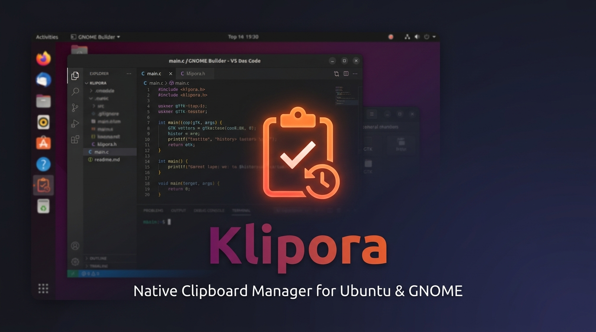
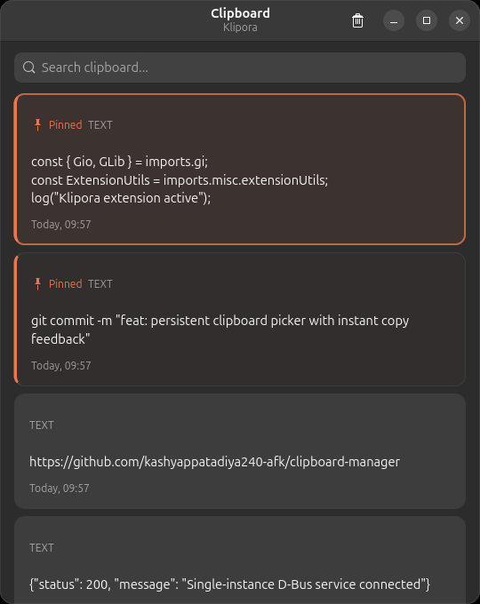
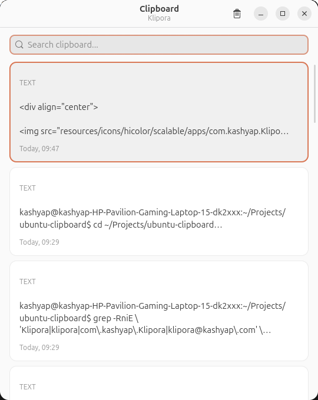

<div align="center">


# Klipora

### Native, Lightweight Clipboard History Manager for Ubuntu & GNOME

[](https://ubuntu.com)
[](https://gnome.pages.gitlab.gnome.org/libadwaita/)
[](https://python.org)
[](https://wayland.freedesktop.org/)
[](https://github.com/kashyappatadiya240-afk/clipboard-manager)
[](LICENSE)

<br/>



<p align="center">
  <b>Klipora</b> is an elegant, lightning-fast clipboard history manager crafted natively for Ubuntu and modern GNOME desktop environments. Seamlessly track copied text and high-resolution images, search past clips in real time, and paste with a single keystroke.
</p>

[Quick Install](#-installation) • [How to Open](#-how-to-open-klipora) • [How to Use](#-how-to-use) • [Keyboard Shortcuts](#️-keyboard-shortcuts) • [Architecture](#️-architecture--storage) • [Troubleshooting](#-troubleshooting)

</div>

---

## 🚀 How to Open Klipora

> **The fastest way to open your clipboard history:**

<div align="center">

### Press <kbd>Super</kbd> + <kbd>V</kbd> anywhere on your desktop

*That's it. No clicking, no searching — just press the shortcut and your full clipboard history pops up instantly, ready to search and paste.*


| What happens | Details |
| :--- | :--- |
| 🟠 **Press `Super + V`** | Clipboard window opens centered on your screen |
| 🔍 **Type to search** | Instantly filters your history in real time |
| ↑↓ **Arrow keys** | Navigate between clipboard items |
| ⏎ **Press `Enter`** | Copies selected item — window stays open |
| **`Esc`** | Hides the window, background monitor keeps running |

</div>

---

## 🎨 App Layout

<div align="center">

| Dark Mode (GNOME Adwaita Dark) | Light Mode (GNOME Adwaita Light) |
| :---: | :---: |
|  |  |

</div>

---

## ✨ Features

* **⚡ Text & High-Resolution Image Tracking**:
  Automatically intercepts copied plain text, rich text, code snippets, and image bitmaps (normalized to lossless PNG).
* **🎯 Global <kbd>Super</kbd> + <kbd>V</kbd> Shortcut**:
  Summon your history popup anytime, anywhere across your entire desktop session.
* **🔄 Persistent Picker with Instant Feedback**:
  Selecting an item copies it immediately to your system clipboard and shows a green checkmark feedback badge while keeping the picker open — allowing you to copy multiple clips in sequence without reopening the window.
* **🔍 Real-Time Full-Text Search**:
  Instant fuzzy search across all your saved history, searching through items exceeding 5,000+ characters with zero lag.
* **📌 Smart Pinning & Automatic FIFO Eviction**:
  * Pin up to 10 essential clips (passwords, email templates, frequently used commands) to keep them permanently stored.
  * Automatic FIFO retention maintains the 20 freshest unpinned clips; older unpinned entries and their image cache are automatically pruned.
* **🔒 100% Offline & Private**:
  All clips are stored locally in an embedded SQLite database. Zero telemetry, zero external network requests, and zero cloud sync.
* **🎨 Native Libadwaita & GNOME Polish**:
  Follows system dark/light accent colors, provides smooth GTK4 hardware-accelerated animations, and preserves native GNOME Mutter window stacking.
* **🛡️ Single-Instance D-Bus Architecture**:
  Reuses existing background daemon; activating the launcher or pressing the shortcut never spawns duplicate processes.

---

## ⌨️ Keyboard Shortcuts

| Shortcut | Action | Description |
| :--- | :--- | :--- |
| <kbd>Super</kbd> + <kbd>V</kbd> | **Open / Toggle History** | Opens your clipboard history from anywhere on the desktop |
| <kbd>↓</kbd> / <kbd>↑</kbd> | **Navigate** | Move focus smoothly between clipboard items |
| <kbd>Enter</kbd> | **Copy Clip** | Copies selected item to clipboard with visual feedback; keeps picker open |
| <kbd>Esc</kbd> | **Dismiss** | Closes and hides the picker window cleanly |
| <kbd>Delete</kbd> | **Delete Clip** | Deletes the focused clip and cleans up associated image files |
| <kbd>Ctrl</kbd> + <kbd>P</kbd> | **Toggle Pin** | Pins or unpins the highlighted clip (up to 10 pinned items) |
| <kbd>Ctrl</kbd> + <kbd>M</kbd> / <kbd>F10</kbd> | **Item Menu** | Opens the contextual actions popover for additional options |
| <kbd>Ctrl</kbd> + <kbd>F</kbd> | **Search** | Moves focus directly to the search bar |

---

## 🚀 Installation

### Option 1: 1-Step User Install (Recommended — No Root/Sudo Required)

Install directly to your user account (`~/.local/`):

```bash
git clone https://github.com/kashyappatadiya240-afk/clipboard-manager.git
cd clipboard-manager
./packaging/install_user.sh
```

This installs:
* Executable script to `~/.local/bin/klipora`
* Desktop application launcher in your GNOME app grid
* High-resolution application icons
* Automatic global <kbd>Super</kbd> + <kbd>V</kbd> keybinding registration

---

### Option 2: Native Debian Package (`.deb`)

Build and install a system-wide Debian package:

```bash
# 1. Build the Debian package
python3 packaging/build_deb.py

# 2. Install using apt (resolves any missing system dependencies automatically)
sudo apt install ./dist/klipora_1.0.0_all.deb
```

---

### Option 3: Running from Source (Development)

Ensure your system has the required GTK4 and Libadwaita packages installed:

```bash
# Ubuntu / Debian system packages
sudo apt update
sudo apt install python3 python3-gi gir1.2-gtk-4.0 gir1.2-adw-1 python3-pil python3-setproctitle

# Clone & set up Python virtual environment
git clone https://github.com/kashyappatadiya240-afk/clipboard-manager.git
cd clipboard-manager
python3 -m venv .venv --system-site-packages
source .venv/bin/activate
pip install -r requirements.txt

# Run application
python3 app.py
```

---

### 🧩 Optional: GNOME Shell Extension (Always-On-Top Layer)

For an elevated experience on Wayland where the clipboard popup floats seamlessly over full-screen apps:

```bash
# Install extension files
mkdir -p ~/.local/share/gnome-shell/extensions/klipora@kashyap.com
cp -r gnome-shell-extension/* ~/.local/share/gnome-shell/extensions/klipora@kashyap.com/
glib-compile-schemas ~/.local/share/gnome-shell/extensions/klipora@kashyap.com/schemas/

# Enable extension
gnome-extensions enable klipora@kashyap.com
```

---

## 💡 How to Use

### 1. Launch & Persistent Background Daemon
Start **Klipora** from your GNOME Applications grid or terminal. The app quietly stays resident in the background and continuously monitors the clipboard:
```bash
klipora
```

### 2. Open Clipboard History — Press <kbd>Super</kbd> + <kbd>V</kbd>
Press <kbd>Super</kbd> + <kbd>V</kbd> anywhere on your desktop. The window opens centered and focused, ready for keyboard or mouse input.

> 💡 **Tip:** You can press <kbd>Super</kbd> + <kbd>V</kbd> again to hide the window, or press <kbd>Esc</kbd> to dismiss it. The background monitor always keeps running.

### 3. Copying & Multi-Clip Pasting
* Click any card or navigate with arrow keys and press <kbd>Enter</kbd>.
* The original content (full text or full-resolution PNG) is placed onto your clipboard.
* A checkmark badge (**Copied**) confirms the copy.
* **The picker remains open**: You can copy an item, switch to another document, or copy multiple items one after another without repeatedly pressing <kbd>Super</kbd> + <kbd>V</kbd>.

### 4. Pinning Favorites
Click the pin button or press <kbd>Ctrl</kbd> + <kbd>P</kbd> on any row. Pinned rows display an accent-colored border and a star icon, ensuring they remain at the top of your list and are protected from automatic eviction.

### 5. Instant Filtering
Type any word into the search bar. The list instantly filters matching items across both pinned and recent clips. Clear the search bar with <kbd>Esc</kbd> or the clear button to restore your full history.

### 6. Dismissing the Window
Press <kbd>Esc</kbd> or click outside the window to hide it. The background monitor stays running, ready for your next <kbd>Super</kbd> + <kbd>V</kbd>.

---

## 🏗️ Architecture & Storage

```
~/.local/share/klipora/
├── clipboard.db       # Embedded SQLite database storing history, types & timestamps
└── images/            # Lossless PNG image files referenced by database entries
```

### SQLite Schema
```sql
CREATE TABLE IF NOT EXISTS clipboard_items (
    id INTEGER PRIMARY KEY AUTOINCREMENT,
    content TEXT,
    content_type TEXT NOT NULL DEFAULT 'text',   -- 'text' or 'image'
    created_at TEXT NOT NULL,                    -- ISO 8601 UTC timestamp
    is_pinned INTEGER NOT NULL DEFAULT 0,        -- 0 = regular, 1 = pinned
    image_path TEXT,                             -- Absolute path to cached PNG file
    image_hash TEXT                              -- SHA-256 hash for deduplication
);
```

### Tech Stack
* **UI**: GTK4 (`Gtk.ListBox`, `Gtk.SearchEntry`, `Gtk.Picture`, `Gtk.Box`)
* **Styling**: Libadwaita (`Adw.Application`, `Adw.ApplicationWindow`, `Adw.HeaderBar`)
* **Database**: SQLite3 with thread-safe connection pooling & automated migrations
* **Images**: Pillow (PIL) for image aspect ratio thumbnailing and normalization
* **IPC**: D-Bus Single-Instance activation (`GApplication` + `Gio.DBusExportedObject`)
* **Global Shortcut**: GNOME Settings Daemon Media Keys GSettings API

---

## 🛡️ Privacy & Security Guarantees

* **Zero Cloud Calls**: No network sockets are ever opened. Your clipboard history never leaves your device.
* **No Telemetry**: No tracking, analytics, or background telemetry of any kind.
* **Sanitized Logging**: Application log output prints only event metadata (e.g. byte length, item ID) and strictly redacts raw clipboard text and image contents.
* **Native Desktop APIs**: Communicates directly through GDK/Wayland clipboard APIs without executing insecure external shell utilities.

---

## 🔧 Troubleshooting

<details>
<summary><b>1. Pressing <kbd>Super</kbd> + <kbd>V</kbd> does not open the window</b></summary>
<br/>

1. Verify that the background process is running:
   ```bash
   pgrep -af klipora
   ```
2. Check if the GNOME custom shortcut is registered:
   ```bash
   gsettings get org.gnome.settings-daemon.plugins.media-keys custom-keybindings
   ```
3. Re-run `klipora` once in a terminal; it automatically repairs and re-registers the keybinding in GSettings.
</details>

<details>
<summary><b>2. "Klipora is already running" message</b></summary>
<br/>

This is expected behavior. **Klipora** enforces a strict single-instance model. Running the command while the app is active notifies the primary process to present the existing window rather than spawning duplicate instances.
</details>

<details>
<summary><b>3. How to change the global shortcut</b></summary>
<br/>

You can customize the shortcut via GNOME Settings:
1. Open **Settings** → **Keyboard** → **Keyboard Shortcuts** → **Custom Shortcuts**.
2. Locate **Klipora History**.
3. Set your preferred key combination (e.g., <kbd>Ctrl</kbd> + <kbd>Alt</kbd> + <kbd>V</kbd>).
</details>

<details>
<summary><b>4. Resetting or clearing all clipboard data</b></summary>
<br/>

To completely reset the history database and stored image cache:
```bash
pkill -f klipora
rm -rf ~/.local/share/klipora
klipora &
```
</details>

---

## 🗑️ Uninstallation

* **If installed via User Script**:
  ```bash
  ./packaging/uninstall_user.sh
  ```
* **If installed via Debian Package**:
  ```bash
  sudo apt remove klipora
  ```

---

## 📄 License

This project is licensed under the [MIT License](LICENSE) — free to use, modify, and distribute for personal and commercial use.

<div align="center">
  
  <br/>
  <sub>Built with ❤️ for the Ubuntu & GNOME open-source community.</sub>
</div>
